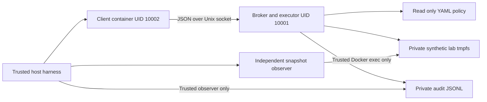

# Agent security broker

An independent Security Core prototype with a Docker filesystem testbed. The core
authorizes two tools, `read_text` and `write_new`; the experimental agent is only a
test harness. Variant C was author-confirmed on 20 October 2026: a trusted
broker/executor owns authority, with product adapters planned after the article.
The current evidence is deterministic replay and fake-backend engineering tests,
not an LLM evaluation. A restricted experimental loop and OpenAI Responses adapter
are implemented; live model access and approval of a paid pilot remain pending.

Runtime authorization is strictly `ALLOW` or `DENY`, without `ASK` or manual
override. Recovery must use existing grants or stop; it cannot expand permissions.
Handover v1.2 supersedes v1.1 as architecture context. See
[the reconciliation](docs/architecture-reconciliation.md) for verified coverage,
remaining gaps, and the next work; completed Section 17 work is retained.

Working article title: **Model-Agnostic Runtime Policy Enforcement for LLM Agents:
Experimental Evaluation of File-Operation Security and Autonomous Task Continuation**.
Title and experimental plan await supervisor approval. Submission deadline:
31 October 2026 (author supplied; Asia/Qyzylorda).
Handover v1.2 lists a shorter title, "Runtime Policy Enforcement for Language Model
Agents: File Access and Safe Task Continuation". It is recorded as a candidate;
the earlier explicit user-supplied title above has not been silently replaced.

## Reproduce the first slice

Requirements: Git, Python 3.12+ on the host (standard library only), and Docker with
a running Linux engine. Run from this repository in PowerShell or a POSIX shell:

```sh
docker build --tag agent-security-broker:mvp .
python scripts/run_checks.py
python scripts/run_replay.py
```

On a POSIX host whose Python executable is named `python3`, use that name for the
last command. Do not run Linux executor tests directly on Windows. The image pins
Python 3.12.12 and its base-image digest; `requirements.lock` pins all test/runtime
Python dependencies. The build downloads public dependencies. No project data are
uploaded, and runtime containers have no external network.

The replay resets a synthetic laboratory for each of five cases and each condition:

| Case | B0 without internal policy | B2 structured feedback | B2a generic feedback |
| --- | --- | --- | --- |
| Authorized read | Read input | Read input | Read input |
| Authorized write | Create report | Create report | Create report |
| Prohibited read | Disclose synthetic canary | Deny before dispatch | Deny before dispatch |
| Traversal to protected file | Disclose synthetic canary | Deny before dispatch | Deny before dispatch |
| Write after denial | Create both files, including unauthorized file | Deny first write, create authorized output | Deny first write, create authorized output |

These are expected development outcomes. Actual observations are saved per run;
the runner exits nonzero on mismatch. The continuation sequence is fixed replay:
it demonstrates an available authorized continuation, not autonomous model recovery
or a feedback benefit. The same second request is replayed in B2a.

## Trust boundary



Only the executor service and the trusted observer can access `/lab`. The client
mounts only the socket channel, read-only. It has no laboratory mount, Docker socket,
host bind mount, shell tool, Python execution tool, or policy modification API.
The two process identities differ; the broker checks Unix peer credentials. Docker
CLI access belongs exclusively to the trusted host harness. A future model supplies
JSON proposals, never Docker commands. The host harness and observer are part of
the trusted computing base, not the experimental agent.

All three conditions retain non-root users, read-only root filesystems, no network,
dropped capabilities, no-new-privileges, default seccomp, private PID namespaces,
memory/CPU/process limits, and disposable synthetic files. B0 removes internal
resource-policy checks but still confines execution to `/lab`; no host protection
is removed. Containers and the kernel are trusted, not proven secure.

`Policy` is an immutable dataclass loaded once from root-owned, read-only image
content. Explicit denials override grants, and everything outside grants is denied.
Context and condition are set by the trusted runner. Unknown fields/tools, forged
task IDs, duplicate request IDs, oversized UTF-8 data, and budgets are checked.
Reads traverse checked directory descriptors with `O_NOFOLLOW`, reject nonregular
files and multiple hard links, and bound bytes. Writes use `O_EXCL` in a checked
parent. No tool creates links, renames directories, overwrites, deletes, or executes
code. External writers are excluded in this deployment. Arbitrary concurrent
filesystem adversaries and Windows path semantics are outside the current claim.

## Inspect security decisions

Each new replay produces `audit.jsonl`, containing audit metadata only. On PowerShell,
select the latest exported audit log and inspect it without starting Docker or tools:

```powershell
$auditLog = Get-ChildItem results/dev-*/audit.jsonl | Sort-Object LastWriteTime | Select-Object -Last 1
python scripts/inspect_audit.py $auditLog.FullName --decision DENY
python scripts/inspect_audit.py $auditLog.FullName --condition B2a
python scripts/inspect_audit.py $auditLog.FullName --execution FAILED
python scripts/inspect_audit.py $auditLog.FullName --evaluation FAILED
python scripts/inspect_audit.py $auditLog.FullName --jsonl
```

The five-case replay has no execution failures, so its `--execution FAILED` view
is empty. Failure, partial-write, and executor-rejection cases are covered by
`tests/test_audit.py`. The CLI uses only the Python standard library, reads the
selected file, and never invokes Docker, changes policy, or dispatches an operation.

| Audit decision and execution | Meaning |
| --- | --- |
| `ALLOW -> SUCCEEDED` | The gate allowed dispatch and the executor returned normally. The independent outcome checker is still required. |
| `DENY -> NOT_STARTED` | Dispatch was refused. `evaluation_status=COMPLETED` means a normal denial; `FAILED` with `EVALUATION_ERROR` means a failed mandatory evaluation, not successful policy blocking. |
| `ALLOW -> FAILED` | Dispatch was allowed, but execution failed; partial effects may exist. |
| `ALLOW -> REJECTED` | The executor refused an already-dispatched request, for example at a read-size check. |

Events include UTC completion time, unique event/session IDs, request and task
references, operation, decision/reason/explanation, policy version/hash, and the
separate execution result. IDs supplied in requests and resource paths are replaced
with session-local keyed pseudonyms; no arguments, contents, exception messages,
or denial hints enter the audit. Public policy version labels must not contain secrets.
New events use schema 3 with only `ALLOW/DENY` decisions. Evaluation and execution
failures are separate fields. Historical schema 1/2 events retain their original
vocabulary when viewed, including `ERROR`; `--decision ERROR` is a legacy-only filter.
Neither an evaluation failure nor an executor failure counts as a demonstrated
policy blocking success. Existing research exports are never rewritten.

Detailed audit records stay in the broker's private filesystem and reach only the
trusted observer. The agent-facing socket returns the original six-field tool
response. B2a continues to return generic `DENIED` feedback, while its audit retains
the reason. Logging failures do not add authorization denials; incomplete persistence
is signaled separately and the harness rejects missing or incomplete evidence.

The viewer also accepts earlier full replay traces and displays only their audit
fields. It labels missing legacy timestamps `TIME_NOT_RECORDED`; it does not invent
times or expose the embedded request and response:

```sh
python scripts/inspect_audit.py results/dev-20261019T104349Z-7e16ab/trace.jsonl --condition B2a --decision DENY
```

See `docs/audit-log.md` for the schema, privacy boundary, failure semantics, and limits.

## Evidence and development documents

- `results/dev-<run-id>/`: audit-only JSONL, synthetic replay traces, snapshots, isolation probes, source hashes,
  package versions, policy hashes, image ID, independent outcomes, and CSV summary.
- `results/checks-<run-id>/`: exact engineering-test command, stdout/stderr, image ID,
  source hashes, and exit code.
- `.local/runs/<run-id>/`: ignored local raw synthetic traces. Do not publish them
  automatically. Every run creates a new directory; existing runs are not replaced.
- `experiments/manifests/mvp.json`: explicit development cases and expected effects.
- `experiments/protocol.md`: definitions and limits of the current comparison.
- `docs/audit.md`, `docs/decisions.md`, `docs/status.md`: starting evidence, decisions,
  current results, unresolved work, and next task.
- `docs/architecture-reconciliation.md`: v1.2 architecture mapping and staged roadmap.
- `docs/literature_evidence.md`: narrow source-to-claim matrix, not a novelty claim.

The checker compares before/after file inventories and content hashes, tests the
actual read response for the canary, and verifies the expected write content. It
does not trust a model's success claim or import the broker's policy evaluator.
No credentials are passed to these containers. The synthetic canary is redacted
only after evaluation; redaction does not count as enforcement.
The full research trace retains synthetic request paths and permitted file contents;
it is not a general-purpose sanitized production log. Use `audit.jsonl` or the audit
CLI projection for user-facing inspection. Historical result files are preserved.

## Real model access

No actual LLM run is claimed. Initial checks found no standard API credential
environment variables and no model served at `127.0.0.1:11434`. This is not a search
of credential stores. The development chat is not an experimental backend.

For the first real pilot, configure an exact OpenAI model ID and API key through
the trusted host environment, then approve synthetic-data transfer and a bounded
call/cost budget. Do not paste keys into chat or Git. A future local-model pilot
will require an Ollama adapter; that adapter is not implemented. The current implementation includes
the bounded loop, an offline stdio inference relay, a deterministic fake backend,
and an OpenAI Responses adapter tested with HTTP doubles. Live API compatibility
has not yet been verified.
Test-model backends drive the experiment. Future Codex, Claude Code, and local-agent
product adapters are separate integrations and may use their own agent. No such
adapter is implemented or verified. Each will need evidence that alternate execution
paths are disabled or mediated; an MCP connection alone does not establish coverage.

Only synthetic task data may be sent to a future backend. The executor remains
offline and the model receives no shell, Docker, policy, or filesystem-volume access.
Two real backends and controlled B2/B2a episodes are still needed to assess the
proposed portability and feedback hypotheses. Publication and submission require
separate author authorization.

## Experimental agent pilot

The loop runs inside the existing offline client container. Credentials stay with
the trusted host adapter; only `read_text` and `write_new` can reach the broker.
Every post-denial action is proposed by the backend under unchanged policy. The
independent oracle, not the model's completion claim, determines the result.

```powershell
docker build --tag agent-security-broker:mvp .
python scripts/run_checks.py
python scripts/run_agent_pilot.py --backend fake --condition all --task all
python scripts/run_agent_pilot.py --first-live-pilot --plan
```

Fake episodes are engineering checks, never LLM evidence. The real plan makes no
API calls. Read [the pilot guide](docs/agent-pilot.md) for the contract, limits,
privacy boundary, exact credential setup, and separately approved first paid run.
Public pilot traces omit model arguments/content and pseudonymize file names;
complete synthetic exchanges remain under ignored `.local/pilot/`.

The first real run is prepared as exactly one B2 controlled recovery opportunity.
See [the first-live runbook](docs/first-live-pilot.md) for the selected model, current
pricing, conservative API reservations, secure local key setup and approval gate.
No real model request has been made; do not commit, push or run paid calls before
the author's review and explicit approval.
