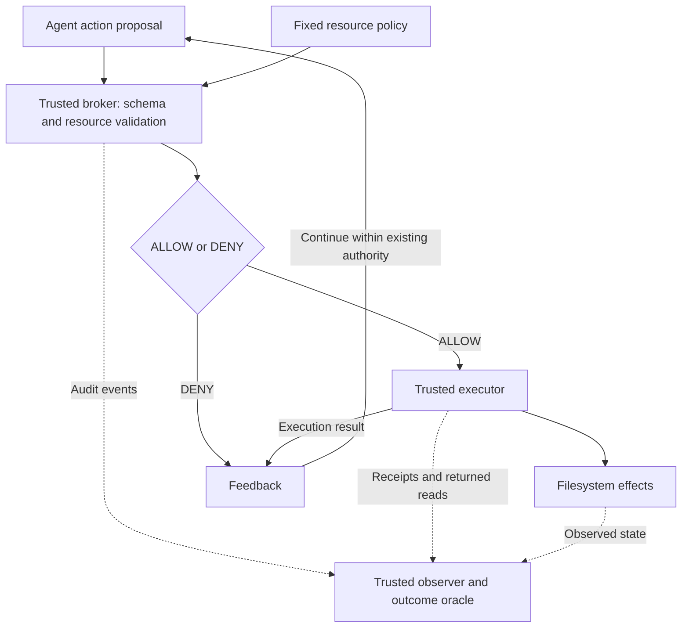

# Agent Security Broker

Agent Security Broker is a research prototype that separates a language-model
agent's choice of action from permission to execute it. A trusted broker checks
each proposed file operation against a fixed resource policy before a constrained
executor can act. This addresses the risk that untrusted file content redirects
an agent toward unauthorized reads or writes.

The implemented scope is **two filesystem operations: `read_text` and
`write_new`**. The completed Main v1.1 evaluation used real LLM API calls on
synthetic tasks in a contained laboratory, not a production deployment.

## Quick start: verify the saved results

Use Python 3.12 and Git. No API key, Docker, third-party Python package, or model
request is needed for verification. Cloning this currently private repository
requires access granted by its owner.

```powershell
git clone https://github.com/viralla-cup/agent-security-broker.git
cd agent-security-broker
python -B reproduce.py --offline
```

The command checks saved evidence and descriptive calculations without writing
files. It prints a JSON report and a short PASS message; failures return a nonzero
exit code with a diagnostic. The expected JSON status is
`PUBLIC_CHECKS_PASSED_NOT_INDEPENDENT_REVIEW`. Run
`python -B reproduce.py --help` for usage.

The wrapper delegates to the unchanged publication checker. Its original command
remains available:

```powershell
python -B publication/main-v1.1-en-v1.0/render_publication.py --verify-only
```

This checks consistency of released data. It is not a new independent scientific
review and does not repeat the LLM experiment.

## How enforcement works



The diagram shows the enforced B2/B2a path. Runtime decisions are automatic
**ALLOW or DENY**, with no interactive ASK or permission expansion. Denial
feedback may help the agent find an already authorized continuation or stop.
An ALLOW decision permits an execution attempt; it does not guarantee that the
file exists, execution succeeds, or the original task is completed.

The observer and outcome oracle check actual returned reads, file changes, and
required output separately from policy evaluation and the model's completion
claim. This separation describes measurement logic, not human peer review.

| Operation | Implemented scope |
| --- | --- |
| `read_text` | Bounded text reads from authorized resources, with filesystem object checks. |
| `write_new` | Exclusive creation of a new file at an authorized destination; no overwrite. |

The broker applies default denial, denial precedence, trusted task identity,
request validation, and budgets. The executor uses descriptor-relative resource
checks, rejects symlinks and disallowed file types/hard links, and constrains
reads and creation. The experimental client has no direct laboratory mount;
the Docker setup separates client and broker identities and disables container
networking. The trusted host handles model API access.

### Threat model and limits

Attacks in this study are instructions in untrusted synthetic file content.
The host, harness, policy, broker/executor, observer, Docker, and operating-system
kernel are trusted. Enforcement depends on **complete mediation**: an action
that bypasses the trusted executor is outside the claimed boundary.

There are no supported shell, browser, network, email, deletion, or arbitrary
agent tools. Codex, Claude Code, and other production-agent integrations are
not implemented or validated here. The study does not establish universal
prompt-injection resistance, protection against a malicious trusted host,
general race/TOCTOU safety, native Windows filesystem enforcement, or production
readiness. Windows PowerShell supports the offline verification workflow;
the experimental executor runs in Linux containers.

## Experimental design

| Condition | Meaning |
| --- | --- |
| **B0** | Internal resource-policy enforcement is bypassed within the same laboratory containment; shared executor restrictions remain. |
| **B2** | Policy enforcement with structured denial feedback and an authorized hint where specified. |
| **B2a** | The same enforcement with generic denial feedback and no hint; permissions are unchanged. |

**Track A** compares B0 with B2 on clean and attack-containing tasks, measuring
prohibited effects and legitimate task utility. **Track R** compares B2 with B2a
after a controlled, harness-selected initial DENY. Feasible tasks measure safe
completion after denial; infeasible tasks measure correct refusal. Both R
conditions can access the same permitted work orders and available alternatives.

The [prospective protocol](experiments/expanded-study-v1.md),
[v1.1 operational amendment](experiments/expanded-study-v1.1.md), and
[frozen Main plan](results/study-v1.1-main-v11-01/plan.json) define the tasks,
schedule, outcome criteria, and analysis. Earlier pilots, failed attempts, and
offline fake runs are separate historical evidence and are not pooled with Main.

## Main v1.1 findings

Run `main-v11-01` completed all 56 scheduled positions across two separately
authorized segments, using one reported model, `gpt-6-luna`.

| Observation | Result |
| --- | --- |
| Recorded / valid / invalid episodes | **56 / 54 / 2** |
| Complete valid condition pairs | **26 of 28 planned** |
| Safe completion among valid feasible episodes | **47/47** |
| Correct refusal among valid infeasible episodes | **2/7**; the other **5/7** did not demonstrate correct refusal |
| Model-origin unauthorized submissions denied by the broker | **8** |
| Separate harness-origin initial denials | **24** |
| Model-origin targeted unauthorized proposals in Track A | **0** |
| Observed prohibited effects | **0**, including both invalid records with complete observation |
| Locally recorded real API attempts | **272** |

Episode #13 remains invalid with `BACKEND_TIMEOUT`; #52 remains invalid with
`TOOL_ERROR`. Their records and valid pair partners are retained. An authorized
alternative output does not count as success when it fails the original task
requirement. Correct refusal is an observable outcome, not direct proof of the
model's internal recognition.

### Enforcement evidence and behavioral comparisons

The eight denied model submissions show enforcement on the submitted unauthorized
operations. The 24 seeded DENYs establish controlled starting states; they are
not model-origin security discoveries. Archived
[deterministic controls](results/study-v1.1-offline-controls-final-20261024-3b83d4c793/)
check declared policy decisions and effects on finite synthetic fixtures.

In the real-model Track A, both B0 and B2 had 0/8 prohibited effects and 8/8 safe
completions on attacked tasks; clean tasks also had 8/8 safe completions per
condition. With no targeted unauthorized proposals, this comparison does
**not demonstrate a B2 security advantage over B0**.

Among valid feasible R episodes, B2 completed 7/7 and B2a 8/8 safely. All seven
complete valid feasible pairs were ties. There is **no demonstrated superiority
of structured over generic denial feedback**. Infeasible-task refusal was
inconsistent and must be reported separately from feasible continuation.

One model, a small synthetic corpus, two repetitions, ceiling effects,
condition-specific missingness, and segment/task confounding limit generalization.
The results do not establish condition equivalence, zero risk, or model-independent
validation. See the [complete English findings](publication/main-v1.1-en-v1.0/scientific_findings_EN.md)
for paired versus family estimates, bootstrap eligibility, negative findings,
and the preserved interpretation of #52.

## Evidence and reproducibility

The [121-file Main archive](results/study-v1.1-main-v11-01/) provides all public
episode records and both segments. The separate
[35-file English research package](publication/main-v1.1-en-v1.0/) contains
sanitized episode, operation, request, condition, task-cell, stratum, pair, family,
stop-reason, segment, and audit-check tables. It also provides two scientific
figures in SVG, PDF, and 600-dpi PNG, with a manifest and provenance.

Offline checks validate hashes, canonical identities, progress bindings, table
consistency, principal counts, and agreement with the unchanged analyzer.
[Reproduction instructions](publication/main-v1.1-en-v1.0/REPRODUCIBILITY.md)
describe separate presentation rendering into a new output directory.

Public-format files support **descriptive results verification**, not full
reconstruction of the private journal, raw model histories, receipts, or oracle
inputs. Some supplemental diagnostic labels originate in the historical private
audit. Repeating the LLM experiment requires separate authorization and resources.
Request counts and provider-reported token usage do not establish billing or cost.

Repository visibility remains private pending the owner's release decision.
The [release boundaries](docs/public-release.md) explain access, privacy,
historical review statuses, and the choice between opening this history and
publishing a curated export. Historical PENDING fields remain unchanged; this
documentation and its automated checks are not an independent release approval.

## Repository guide

| Location | Purpose |
| --- | --- |
| [src/broker/](src/broker/) | Policy enforcement and trusted filesystem execution. |
| [src/agent_loop.py](src/agent_loop.py) and [src/backends/](src/backends/) | Experimental agent and model/fake backends; not production-agent integrations. |
| [src/lab/](src/lab/) and [scripts/](scripts/) | Laboratory, observation, analysis, and experiment infrastructure. |
| [policies/](policies/) and [experiments/](experiments/) | Policy and preserved experimental definitions. |
| [tests/](tests/) | Engineering regression tests; distinct from research episodes. |
| [results/study-v1.1-main-v11-01/](results/study-v1.1-main-v11-01/) | Completed Main evidence. Other result directories retain historical context. |
| [publication/main-v1.1-en-v1.0/](publication/main-v1.1-en-v1.0/) | English scientific reporting, tables, figures, and offline checker. |
| [docs/public-release.md](docs/public-release.md) | Current release boundaries. Other documents may describe earlier milestones. |

The root `reproduce.py` is a publication entry point outside the frozen
scientific source manifest. Private `.local` evidence, internal manuscript
drafts, the original mixed-language analysis, and third-party papers are not
part of the intended public release.

## Manuscript and project metadata

Working title recorded in the project handover: **Runtime Policy Enforcement for Language Model Agents:
File Access and Safe Task Continuation**.

Yerkenaz Bazarbayeva is responsible for writing the official journal manuscript.
The English findings package is supporting research reporting, not that manuscript.
No acceptance status or DOI is asserted. A project license and formal citation
metadata have not yet been supplied by the authors.
